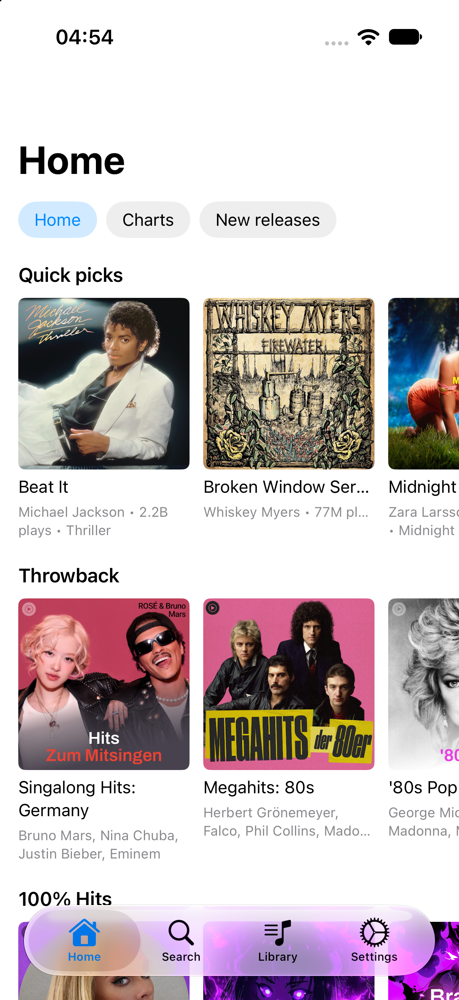

# Final Music for iOS

An independent SwiftUI port of the open-source Android client
[LastWave-Native](https://github.com/Clash-Projects/LastWave-native): browse,
search and play YouTube Music anonymously, with synced lyrics and Last.fm
scrobbling.



## What works

| Surface | What it does |
| --- | --- |
| **Home** | Chips (Home · Charts · New releases) over the real `FEmusic_*` feeds; song shelves and collection carousels, per-shelf *Play all*. YouTube's charts page carries only "Video charts" + "Top artists" for anonymous clients (the songs row list comes back empty), so the Charts chip tops itself up with the home feed's trending shelf |
| **Search** | Filter chips — Songs · Albums · Artists · Videos · Playlists — using the real WEB_REMIX filter params; tapping a result opens its album/artist/playlist page |
| **Album / Artist / Playlist** | Header (artwork, title, `Playlist • 2023 • 6.6K views • 42 tracks • 3 hours, 23 minutes`), Play / Shuffle / **Remix**, then the track list plus Top songs, Albums, Singles & EPs, Videos… Playlists read `musicPlaylistShelfRenderer`, albums/artists `musicShelfRenderer` |
| **Remix (radio)** | `/next` with `playlistId = RDAMVM<videoId>` — YouTube Music's own mix for a song, artist or album. The queue extends itself with the continuation token while it plays |
| **Library** | Liked Songs, user playlists (create / rename / delete / add / remove) and Recently played, all persisted locally |
| **Player** | Artwork, synced lyrics (LRCLIB), scrubber, shuffle, repeat, like, add-to-playlist, remix, queue sheet with **drag-reorder and swipe-remove**, lock-screen controls and background audio |
| **Last.fm** | Bring-your-own keys; now-playing + scrobble at half duration (≤ 4 min), love sync |
| **YouTube Music sync** | **Connect with YouTube** opens the browser for Google's device-code approval, then imports the account's liked songs and playlists and mirrors in-app likes back to the account; a raw `Cookie:` header / JSON export is the fallback. Credentials stay on device |
| **For You** | Local algorithmic mix (no account): scores real playback signal — listened time, skips, likes, recency, time of day — then expands the strongest tracks through YouTube Music's related songs, with per-artist caps and a junk-title filter. Ported from the Android client's `LocalTasteSuggestionEngine` |
| **Deep links** | `lastwave://play/<videoId>` plays a track; `lastwave://lastfm?token=…` completes the web auth |

Everything else — the playable bytes — goes through the same three layers as the
MiniTube experiment: WEB_REMIX catalog calls, a `VISIONOS` player profile for
stream URLs, and a localhost byte-range proxy so AVPlayer never talks to
googlevideo directly.

## Structure

```
FinalMusic/
  FinalMusicApp.swift        @main, tabs, mini player, TrackRow, launch hooks
  HomeFeedView.swift       chips + shelves/carousels
  SearchView.swift         filters + results
  CollectionDetailView.swift  album/artist/playlist page + Route
  LibraryView.swift        liked / playlists / history / add-to-playlist
  PlayerScreen.swift       player, lyrics, queue
  PlayerViewModel.swift    AVPlayer, queue, radio, scrobble, lock screen
  InnerTubeAPI.swift       categories: search/home (WEB_REMIX), parsing
  InnerTubeBrowse.swift    shelves, entities, collection pages, radio (/next)
  StreamExtractor.swift    player clients, format ranking, client health
  LocalStreamProxy.swift   localhost byte-range proxy for AVPlayer
  ArtworkCache.swift       two-level artwork cache (NSCache + bounded disk)
  ArtworkCore.swift        cache policy: URL sizing, eviction, dedupe (core-checked)
  QueueCore.swift          queue reorder/removal/advance rules (core-checked)
  CarPlayScene.swift       scene-based CarPlay dashboard (entitlement-gated)
  Library.swift            liked/playlist/history stores (JSON in UserDefaults)
  LastFm*.swift, LRCLIBClient.swift, IntegrationCore.swift, Stores.swift, SettingsView.swift
```

## Two-level artwork cache

`ArtworkCache` (actor) replaces AsyncImage in every artwork slot:

* **Memory** — NSCache of *decoded, downsampled* UIImages keyed by `size|url`,
  cost-capped at ~60 MB. Rows request 144 px, cards 450 px, the player 750 px,
  so a 1280 px original is never decoded for a 48 pt row
  (`ArtworkPolicy` rewrites yt3/i.ytimg URLs to the smallest covering variant).
* **Disk** — original bytes under `Caches/LastWaveArtwork`, keyed by a stable
  FNV-1a hash (survives relaunches; Swift's `hashValue` is seeded per process).
  Age limit 30 days, 150 MB budget, LRU eviction swept in the background
  (`CacheEviction`).
* **Dedup + prefetch** — `DedupeLedger` makes a visible load and a prefetch of
  the same variant race nobody: the second waiter returns the first one's
  result. Home feeds prefetch the head of every shelf, collection pages their
  first 15 rows + header, and `prefetchNext` warms the next track's large cover
  with its stream.
* Everything runs off the main thread (actor + ImageIO
  `CreateThumbnailAtIndex`), so scrolling pays for a cache lookup, not a decode.

## CarPlay

`CarPlaySceneDelegate` (scene-based lifecycle:
`CPTemplateApplicationSceneSessionRoleApplication`, wired in Info.plist's
`UISceneConfigurations`) offers a **My Library** list (Liked Songs, playlists
with cached covers) and **Recently Played**, plays through the *same*
`PlayerViewModel` (`PlayerViewModel.current` bridge — no second audio engine),
and presents the shared `CPNowPlayingTemplate` whose transport and metadata
come from the engine's existing MPNowPlayingInfoCenter/MPRemoteCommandCenter
integration. "Up Next" pushes the live queue.

CarPlay **cannot run without the approval-gated audio entitlement**
(`com.apple.developer.carplay-audio`; the iOS 27 SDK has dropped
`CPApplicationDelegate` entirely, so scenes are the only path). Without it iOS
never offers the scene — the phone app is fully unaffected and nothing in that
file runs. To ship with CarPlay:

1. Request the entitlement (Music category) at developer.apple.com →
   Identifiers → your App ID → Capabilities, after Apple approval.
2. Set `CODE_SIGN_ENTITLEMENTS = FinalMusic/FinalMusic-carplay.entitlements` in the
   shipping configuration (kept out of the default build on purpose: signing
   with a profile lacking the capability fails the whole app).
3. Test against a real CarPlay head unit. The scene deliberately reports no
   more than "implemented, entitlement-gated, hardware-unverified".

## Testing

`swift run FinalMusicCoreChecks` executes the pure cores on the host — no
simulator, no network — and the app target compiles the *same files* into the
product, so checks and shipping code cannot drift. Current suites:

| Area | What is pinned |
| --- | --- |
| InnerTube parsing | search/browse response decode, renderer shapes, dedupe |
| Last.fm | api_sig vectors, normalizeKey, ScrobblePolicy edges (≥ half duration ≤ 240 s, > 30 s) |
| Lyrics | timestamp parse/sort, multiple tags per line, active-line lookup |
| YouTube auth | SAPISIDHASH vector vs Python hashlib, OAuth token parse/refresh |
| For You | score vectors, day-part boundaries, artist caps, seed/dedupe rules vs the Kotlin engine |
| Artwork cache | yt3/i.ytimg URL rewriting, FNV-1a disk keys (vs Python), LRU+age eviction, dedupe ledger |
| Queue | move/remove arithmetic incl. SwiftUI-identical destination semantics, removal index shift, the full advance decision table (shuffle collision, repeat, radio, stop) |

Playback beyond the pure cores is verified headlessly on the simulator via the
launch hooks below (`LWLOAD`/`LWPREFETCH`/`LWRADIO` log trail), not by tapping.

## Build & run

```sh
swift run FinalMusicCoreChecks                 # parser / signer / scrobble checks

GEM_PATH="$HOME/.gem/ruby/2.6.0:/Library/Ruby/Gems/2.6.0" /usr/bin/ruby sync_sources.rb
xcodebuild -project FinalMusic.xcodeproj -scheme FinalMusic \
  -destination 'platform=iOS Simulator,name=iPhone 17' \
  -derivedDataPath derived build CODE_SIGNING_ALLOWED=NO
xcrun simctl install booted derived/Build/Products/Debug-iphonesimulator/FinalMusic.app
xcrun simctl launch booted app.lastwave.ios
```

Run `sync_sources.rb` after adding or deleting a file in `FinalMusic/`
(`FinalMusicCoreChecks` also compiles the pure-core files via
`Package.swift` — add new pure files to both).

## Install on a physical iPhone

1. Open `FinalMusic.xcodeproj` in Xcode 27, select the **FinalMusic** target →
   *Signing & Capabilities* → choose your Team. A free personal team is
   enough; keep the bundle id or change it to one you own. The 27.1 SDK
   builds against iOS 17.0+, so any iPhone on iOS 17 or newer works.
2. Plug the phone in, pick it as the destination, **Run (⌘R)**. On first
   launch: *Settings → General → VPN & Device Management* → trust your
   developer certificate. Free teams expire the signature after 7 days —
   just rebuild.
3. `NSAppTransportSecurity/NSAllowsLocalNetworking` and the `audio`
   background mode ship in `FinalMusic/Info.plist`; the localhost stream proxy
   and lock-screen controls work the same on device as in the simulator.
   Keychain storage of Last.fm/YouTube credentials needs the signing above
   (unsigned builds fall back to the app container, which the Settings
   footer reports).
4. For CarPlay, follow the three steps in the CarPlay section above —
   the entitlement is approval-gated and deliberately not in the default
   build.

## Launch hooks (headless testing)

Launch arguments land in UserDefaults' argument domain, so every screen can be
driven without tapping:

```sh
xcrun simctl launch booted app.lastwave.ios -StartTab search -AutoSearchQuery "daft punk"
xcrun simctl launch booted app.lastwave.ios -StartTab search -AutoSearchKind album \
    -AutoSearchQuery "random access memories" -AutoOpenFirstEntity 1
xcrun simctl launch booted app.lastwave.ios -StartRadioVideoId 5NV6Rdv1a3I   # remix radio
xcrun simctl launch booted app.lastwave.ios -StartRadioVideoId 5NV6Rdv1a3I \
    -AutoQueueMutate 1                            # queue move+remove, logs LWQUEUE mutate
xcrun simctl launch booted app.lastwave.ios -AutoPlayVideoId 5NV6Rdv1a3I    # play + open player
xcrun simctl launch booted app.lastwave.ios -AutoLikeVideoId 5NV6Rdv1a3I    # play then like
xcrun simctl launch booted app.lastwave.ios -SeedPlaylist "Test Mix"        # playlist from history
xcrun simctl launch booted app.lastwave.ios -StartChip charts               # which feed chip to open
xcrun simctl launch booted app.lastwave.ios -AutoOpenCollection VLPL…       # push a page on Home's stack
xcrun simctl launch booted app.lastwave.ios -AutoPlayCollection VLPL… \     # play a page's list
      -AutoSkipAfter 14                                                     # …then advance the queue
xcrun simctl launch booted app.lastwave.ios -AutoConnectBrowser 1 \        # browser sign-in (device code)
      -SuppressBrowserOpen 1                                                # …without Safari stealing focus
xcrun simctl launch booted app.lastwave.ios -AutoConnectCookies "SID=…; SAPISID=…"   # cookie fallback
xcrun simctl launch booted app.lastwave.ios -AutoSyncYouTube 1               # pull liked songs + playlists
xcrun simctl launch booted app.lastwave.ios -ExpireYouTubeToken 1            # force the OAuth refresh path
xcrun simctl launch booted app.lastwave.ios -AutoKeychainSelfTest 1          # credential storage self-test
xcrun simctl launch booted app.lastwave.ios -SeedPlayStats 1 \              # synthetic listening history
      -ForYouRoot 1 -AutoForYou 1                                           # …build the For You mix headlessly
```

The For You engine logs `LFY stats_seeded` and
`LFY built picks=N seeds=M fallback=yes|no summary=…`, plus `LFY related_failed`
when a seed's related-songs call fails.

Account sign-in logs a trail you can read back with
`xcrun simctl spawn <udid> log show --last 30s --predicate 'process == "FinalMusic"'`:
`LWOAUTH device_code user_code=… url=…`, `LWOAUTH connected name=… auth=bearer|cookie`,
`LWOAUTH token_refreshed`, `LWOAUTH bearer_rejected`, and `LWSYNC liked remote=… added=…`
/ `LWSYNC playlists remote=… imported=…` after a sync.
```

Playback logs its own trail, which is how these are checked without taps:
`LWHOME` (shelves parsed per feed), `LWCOLL` (page title/kind/track count),
`LWQUEUE` (queue size + start index), `LWLOAD <n>/<total> … -> <edge host>` and
`LWLOAD error`. A list that resolves to `0 tracks` in `LWCOLL` and a queue that
never logs `LWLOAD` are the two failure shapes to look for.

`-StartTab` accepts `home|search|library|settings`; `-AutoSearchKind` accepts
`song|album|artist|video|playlist`; `-StartChip` accepts `home|charts|new releases`.

## Not ported (deliberately)

The Android app is much larger; these are out of scope for this port and would
each be their own project:

- **Account features** — sign-in *is* there now (cookie header → liked songs,
  playlists, likes), but not: account history sync, editing playlists on
  YouTube, subscriptions, or the Spotify/Google logins.
- **Downloads / offline**, **lossless (clashflac)** and the **exclusive USB
  audio driver**.
- **Podcasts, friends/friend profiles, listening stats**, AutoEq, canvas
  artwork, mood/genre explorer, CSV/Spotify playlist import.

## YouTube Music sync details

- **Connect with YouTube** (Settings, or Library → YouTube Music) requests a
  Google device code, opens the browser at `google.com/device`, shows the code
  in-app, and polls until the account is approved — so the account is verified in
  a real browser (embedded web views are refused by Google, and an
  `SFSafariViewController` session is unreadable by apps by design).
  Needs the TV-&-Limited-Input OAuth client used by yt-dlp/InnerTubeX with the
  full `youtube` scope (`youtube.readonly` is refused: `restricted_client`).
  Access tokens are refreshed from the stored refresh token before each call.
- The fallback is a `Cookie:` request header (or JSON export) from a signed-in
  browser, signed with SAPISIDHASH.
- OAuth calls send `Authorization: Bearer …`; verified live that the music
  endpoints accept it (`401 … Expected OAuth 2 access token, login cookie or
  other valid authentication` for a bad one).
- Cookie calls sign the same way YouTube's own web client does:
  `Authorization: SAPISIDHASH <seconds>_<sha1("<seconds> <SAPISID> https://music.youtube.com")>`
  plus `X-Goog-AuthUser: 0` and `Origin: https://music.youtube.com`. The parsing
  and signing are covered by `FinalMusicCoreChecks` against hashes computed
  independently with hashlib.
- Signed-out calls still answer **HTTP 200**, so the app detects "not signed in"
  from the *shape* of the response (no `activeAccountHeaderRenderer`; a
  `messageRenderer` on the library pages) and says so instead of reporting
  "0 songs". `like/like` is the exception: it answers **401 You must be signed in**
  with bad cookies, which is how the request path was checked.
- A sandboxed/unsigned build has no `keychain-access-group` entitlement
  (`SecItemAdd` → `-34018`), so credentials fall back to the app container and
  the Settings footer says which store is in use.

## Disclaimer

Educational project. Not affiliated with, endorsed by or sponsored by YouTube,
Google or Last.fm. All content and metadata come from public endpoints; nothing
is hosted or redistributed.

## Bug-fix pass (audit findings, each verified live)

| # | Bug | Fix |
| --- | --- | --- |
| 1 | Rapid double-skip could leave the *earlier* tap playing: overlapping resolves raced and the slower one won | monotonic `loadSequence`; a resolve that finishes after a newer load is dropped (`LWLOAD stale sequence … dropping` — observed live) |
| 2 | An old track's `AVPlayerItem` failing after advancing reloaded the *wrong* (newer) track | failure observer now only acts when the failed item is still the current one |
| 3 | Lock-screen pause/play bypassed the play-time bookkeeping, counting paused minutes as played | dedicated remote handlers that flush/re-anchor like the in-app toggle |
| 4 | `play(videoId:)` re-resolved the stream even when that track was already current | early return before the network call |
| 5 | Dead `FavoriteStore` (superseded by `LikedStore`, with a stale header claim) | deleted |
| 6 | `LocalStreamProxy.register()` polled with `usleep` on the main actor — up to 6 s of UI freeze on a bad bind — and its token/status maps grew forever | async `Task.sleep` polling; insertion-order eviction keeping the newest 8 registrations |
| 7 | Play stats re-encoded and wrote to `UserDefaults` on every 15 s flush and transition | 2 s debounced persistence (verified: stats still exact — `ms=8049` on an 8 s play) |
| 8 | Warmed next-track streams for tracks skipped past lingered (expiring URLs) | stale prefetches evicted when a track loads |
| 9 | Each search submit/chip-tap spawned an uncancellable `Task`; an older response could publish over a newer one | one `searchTask` handle: supersede = cancel + restart, and `run` re-checks `Task.isCancelled` before every assignment (the URLSession async bridge turns cancellation into a cancelled request) |
| 10 | Album/playlist track rows rendered grey thumbnails forever (the renderer carries no per-row art) | rows backfill the page header's cover during `browseCollection` parsing |
| 11 | No mini player on pushed pages (collection/library/search-detail) — a playing track became unreachable from exactly the screens you tap "Play" on | the tab content *and every pushed route* now inset the MiniPlayer (except the player itself); verified on the Top-100 chart playlist page |
| 12 | Pull-to-refresh on Home/Charts could permanently replace a working feed with "Could not load the feed / cancelled" | `load()` never clears `shelves` before success, and a cancelled `.refreshable` Task (routine — the control cancels when it idles) no longer publishes an error |

## Performance / polish pass

Measured on the iPhone 17 simulator, not estimated:

| Tuning | Before | After |
| --- | --- | --- |
| "For You" build (seed expansion) | ~26 000 ms, sequential | **~2 300 ms** — seed expansions run concurrently, results are still admitted in seed order so the per-artist cap and de-duplication stay deterministic |
| Liked-songs top-up fan-out | unbounded (one related-songs call per liked song, sequential) | bounded to `LocalTaste.maxLikedFillSeeds` (12) and fetched concurrently — an iOS deviation from the Android engine, noted in code |
| Track transition | resolves the next stream on demand (~1 s round-trip) | next queue entry is resolved while the current track plays: `LWPREFETCH stored` → `LWPREFETCH hit` → `LWLOAD` in ~0.1 ms |
| AVPlayerItem policy | defaults | `preferredForwardBufferDuration = 30` (a music stream shouldn't pull far ahead over the localhost proxy) and `canUseNetworkResourcesForLiveStreamingWhilePaused = false` |
| Artwork pipeline | AsyncImage: one memory-less decode per view, original-size fetches, duplicate prefetch/visible fetches | two-level `ArtworkCache`: decoded NSCache + stable-hash disk, size-token URL rewriting (a 48 pt row fetches 144 px), ImageIO decode-time downsampling off the main thread, dedupe ledger, and shelf/page/next-track prefetch |

Both item-creation paths share `makeItem(for:)`, so the buffer policy cannot
drift between the normal load and the retry path. `-AutoSkipAfter` now also works
with `-AutoPlayVideoId` and `-StartRadioVideoId`, which is how the prefetch and
play/skip recording are exercised headlessly.

## Provenance of the "For You" port

Scoring and filters were read from the Android client
(`app/src/main/java/com/lastwave/app/data/generate/LocalTasteSuggestionEngine.kt`)
and checked against the **released artifact**. REA (rea-agents 6.8.0) produced
these records for `LastWave-v4.3.1-universal.apk`
(sha256 `6209eb8e3631bfc9bef9ff478eb63082e309a62850e5475dd4f6c39912e5287c`,
matching the release's own `SHA256SUMS.txt`):

| Evidence | Operation | What it established |
| --- | --- | --- |
| `ev_02d7371b8cdfbd1c344033c2d13df27e645feea75ffa9979b0f60b2cbaae7c0e` | `inspect_apk_signature` | v1+v2/v3 signing, self-signed `CN=LastWave Release`, cert SHA-256 `ed79fe6fd316b592eed4aab8831ea83f8cd0923e6e5b08d1e6a7ac7fd20951d0` |
| `ev_d2c4130d0e7624b7b1120e123c41c78d6826b43cee98ae54af0b33c980167c01` | `inspect_artifact` | 3 DEX, `resources.arsc`, 36 native libs across 4 ABIs — `libquickjs.so` + `assets/po_token.html` (BotGuard PO tokens), `libffmpegJNI.so`, `liboboe.so`, `libsoxr.so`, `libdecent_usb_audio.so` |
| `ev_123d9ad4e8b01b7c7e7a056350772a23f3e12c1d3bcdd595fe0eb520df17650c` | `decode_android_resources` | `com.lastwave.app` 4.3.1 (code 26), minSdk 29 / targetSdk 35, 12 permissions incl. `FOREGROUND_SERVICE_MEDIA_PLAYBACK`, `playback.MusicPlaybackService`, `data.download.*`, two widget receivers |

The inventory is also the honest boundary of this port: the shipped app streams
losslessly and survives YouTube's bot checks because it carries QuickJS-based PO
tokens, ffmpeg, Oboe and a USB audio driver. This iOS port deliberately omits all
of that and uses the visionOS player profile instead — so no lossless/clashflac,
no SABR, no USB-exclusive output.
